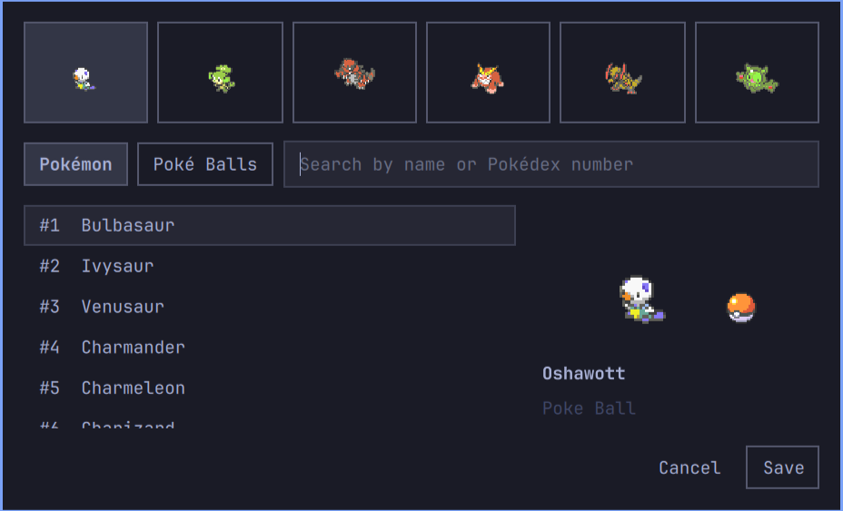
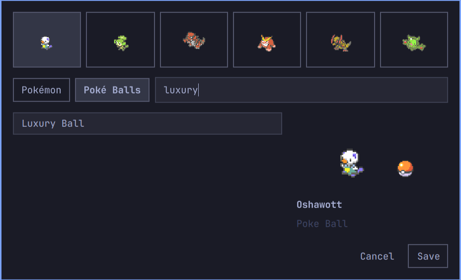

# Pokéspaces

Your Pokémon team, right in Omarchy's workspace bar.


Pokéspaces replaces the workspace indicator with six configurable Pokémon slots. The rest of your bar stays intact. Each monitor shows the same team, with its own active workspace animated independently.

**Version 0.1.0** · Omarchy Quattro / Quickshell · Python standard library only

## Requirements

- Omarchy Quattro with the Quickshell plugin system, including `BarWidget`, `WidgetButton`, `Panel`, `KeyboardPanel`, and `ButtonGroup`.
- Hyprland with Lua dispatchers.
- Python 3.10 or newer and Git.
- Access to `raw.githubusercontent.com` for uncached Pokémon and balls.

Verified on Omarchy **4.0.6-1**, its bundled Quickshell **0.3.2**, and a horizontal bar across three monitors. Vertical layouts are implemented but have not been visually verified. Older Waybar-based Omarchy releases are not supported.

## Install

Clone the repository and run the installer as your normal user:

```bash
mkdir -p ~/Repositories
git clone https://github.com/lilfrogdev/omarchy-pokespaces.git ~/Repositories/omarchy-pokespaces
cd ~/Repositories/omarchy-pokespaces
python3 scripts/install.py
```

The installer validates the plugin, copies it into your Omarchy plugin directory, replaces the stock `omarchy.workspaces` widget at its existing position, and reloads the shell configuration. It creates a timestamped `shell.json.before-pokespaces-*` backup and preserves unrelated bar entries and settings. Running it again updates the installed copy.

It also installs the `pokespaces` command in `~/.local/bin/`. Keep that directory on your `PATH`. No sudo, pip packages, or image conversion tools are needed.

The installer expects a stock workspace widget or an existing Pokéspaces widget. If you use a different workspace plugin, restore the stock widget before installing.

For Omarchy's native Git-managed installation on a standard configuration:

```bash
omarchy plugin add https://github.com/lilfrogdev/omarchy-pokespaces.git --yes
python3 ~/.config/omarchy/plugins/lilfrogdev.pokespaces/scripts/install.py
```

The second command performs the workspace replacement and CLI installation. For a custom `XDG_CONFIG_HOME`, use the checkout installation above; the installer respects it.

## Read your workspaces

| Workspace state | What you see |
| --- | --- |
| Active on this monitor and occupied | Your assigned animated Pokémon |
| Occupied and inactive on this monitor | Your assigned Poké Ball |
| Empty, whether active or inactive | A white dot |
| Workspace 7 or higher, while it exists | Its ordinary number |

The first six slots always occupy the same space, so the bar does not shift as windows open or close. “Active” means displayed on that monitor, independently of which monitor has keyboard focus.

- **Left-click** a slot to switch workspace.
- **Right-click** a slot to edit that team member.
- **Hover** a slot to see its workspace number and Pokémon name.

## Build your team



1. Right-click a workspace slot. The picker opens with that slot selected.
2. Select any of the six icons along the top to edit another slot.
3. Choose **Pokémon** and search by name or Pokédex number. Click a result to select it.
4. Choose **Poké Balls** and search for a ball. Both selections appear in the preview.
5. Press **Save** to apply all six slots across every monitor.

**Cancel**, Escape, or clicking outside the picker discards unsaved changes. Duplicate Pokémon and balls are allowed. In the search field, use Up/Down to move through results and Enter to choose one; Tab moves between controls.



Screenshots show an example customized team. New installations start with:

| Slot | Pokémon | Poké Ball |
| --- | --- | --- |
| 1 | Gengar | Master Ball |
| 2 | Dragonite | Dusk Ball |
| 3 | Sandile | Great Ball |
| 4 | Umbreon | Net Ball |
| 5 | Pikachu | Quick Ball |
| 6 | Eevee | Luxury Ball |

The catalog includes **649 standard Pokémon** and **27 capture balls**. Pokémon use animated Gen V party icons. Shiny Pokémon are not supported.

## Use an agent or the CLI

Ask your agent something like:

> Put Umbreon in workspace slot 3 with a Luxury Ball. Keep the other slots as they are.

The supported commands are documented in [AGENTS.md](AGENTS.md). Agents can inspect, search, and change the team without opening the picker or restarting the shell:

```bash
pokespaces team show --json
pokespaces pokemon search umbreon --json
pokespaces balls list --json
pokespaces team set --slot 3 --pokemon umbreon --ball luxury-ball --json
```

`team set` accepts Pokémon names or numeric Pokédex IDs, and ball names or catalog IDs. Names are case insensitive and normalize spaces, punctuation, and accents. Use `Nidoran♀` / `Nidoran♂`, `nidoran-female` / `nidoran-male`, or IDs 29 / 32 to distinguish Nidoran. Omitted options keep their current values; other slots are preserved.

Export or apply an entire team:

```bash
pokespaces team show --json > team.json
pokespaces team apply --file team.json --json
```

`team apply` accepts an exported document or a six-slot array containing numeric `pokemon` IDs and string `ball` IDs. `--file -` reads JSON from stdin. All six slots are validated before an atomic save.

Every command supports `--json` and never prompts. JSON includes `ok`; errors include `error`, and saved-team responses include `warnings` for unavailable downloads. Exit codes are **0** for success, **1** for an operation or configuration error, and **2** for invalid command syntax. A download warning does not mean the team failed to save.

Read-only commands do not download assets or create configuration files. Before installation, substitute `python3 scripts/pokespaces.py` for `pokespaces` from the checkout directory.

Save in the picker replaces the complete team. If an agent changes the team while you have unsaved picker edits, cancel and reopen before editing further to avoid overwriting those changes.

## Downloads and offline use

Sprite assets are downloaded only for the saved team and selected previews. Browsing search results does not download the whole catalog. Selected assets share a local cache across monitors.

| Data | Location |
| --- | --- |
| Saved team | `$XDG_CONFIG_HOME/omarchy-pokespaces/team.json` |
| Asset cache | `$XDG_CACHE_HOME/omarchy-pokespaces/` |
| Installed plugin | `$XDG_CONFIG_HOME/omarchy/plugins/lilfrogdev.pokespaces/` |

Unset XDG variables default to `~/.config` and `~/.cache`, respectively.

Cached selections work offline. A missing Pokémon falls back to its ball, then to a white dot. Downloads do not prevent workspace switching. Reopen the picker to retry unavailable assets. Clearing the cache requires downloading the selected sprites again; it does not erase the saved team.

The repository contains metadata and cropped UI documentation captures, not a bundled sprite collection or runtime sprite assets. Downloads come from [PokéAPI/sprites](https://github.com/PokeAPI/sprites) at revision `97a7832d307311c0e1c6ea9035308bf80cc94f81`.

## Update or restore

For a checkout installation:

```bash
cd ~/Repositories/omarchy-pokespaces
git pull --ff-only
python3 scripts/install.py
```

For a native Git-managed installation, use `omarchy plugin update lilfrogdev.pokespaces` and rerun the installed `scripts/install.py`.

To return to ordinary workspace numbers:

```bash
python3 "${XDG_CONFIG_HOME:-$HOME/.config}/omarchy/plugins/lilfrogdev.pokespaces/scripts/install.py" --restore
```

Restore preserves the rest of your bar, saved team, cache, and CLI. It does not uninstall the plugin. Timestamped shell backups remain beside `shell.json` if you need your earlier configuration.

## Troubleshooting

- **Old picker layout after updating:** nested QML components can remain cached. Run `omarchy restart shell` once after installation if changes do not appear.
- **Only dots or balls:** Pokémon appear only on occupied workspaces active on that monitor. For unavailable assets, check your connection and reopen the picker.
- **`pokespaces` not found:** ensure `~/.local/bin` is on `PATH`, or invoke the installed `scripts/pokespaces.py` with Python directly.
- **Existing `pokespaces` executable:** the installer refuses to overwrite a different command. Rename or relocate that command before retrying.
- **Saved team cannot be read:** use `team apply` with a valid exported team file. It validates the replacement before saving.

## Development and release review

QML implements the bar and picker. `scripts/pokespaces.py` handles validation, persistence, downloads, caching, and APNG frame compositing using Python's standard library. Qt's PNG loader does not animate these party icons, so cached frames play with their original timing in QML.

Run `omarchy plugin validate .` from the checkout, and rerun the installer after source changes. See the [0.1.0 readiness review](docs/RELEASE-REVIEW.md) for verified behavior and remaining limits.

## Credits and licensing

New plugin code is [MIT licensed](LICENSE). Workspace behavior is adapted from [Omarchy](https://github.com/omacom/omarchy); its MIT notice is preserved in [OMARCHY-LICENSE](OMARCHY-LICENSE).

Pokémon metadata and downloaded artwork come from [PokéAPI/sprites](https://github.com/PokeAPI/sprites); English names originate from the PokéAPI species-name dataset. The [upstream sprite notice](data/SPRITES-LICENCE.txt) states that the repository is distributed under CC0 and its image contents are copyright The Pokémon Company. Pokémon artwork also appears in the UI screenshots and GIF. The code license does not relicense that artwork or Pokémon trademarks.

Pokéspaces is an unofficial fan project, unaffiliated with or endorsed by The Pokémon Company, Nintendo, Game Freak, or Creatures.
